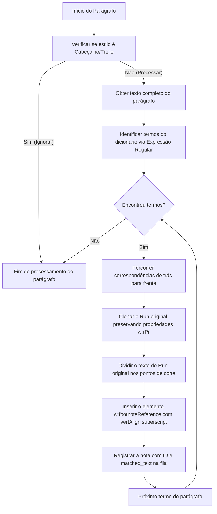

# Especificação Técnica: Footnote Injector by Jair Lima

Este documento estabelece as especificações técnicas, arquitetura e fluxo de trabalho do aplicativo para injeção automática de notas de rodapé em arquivos Microsoft Word (.docx). O objetivo principal é automatizar a explicação de termos pouco conhecidos ou técnicos em livros e documentos tecnológicos.

---

## 1. Objetivo e Escopo

O objetivo do projeto é desenvolver um utilitário em Python capaz de ler um arquivo `.docx`, identificar termos pré-definidos em um dicionário e inserir notas de rodapé correspondentes de forma automatizada.

### Requisitos Funcionais
* **Varredura Inteligente**: O aplicativo deve buscar termos técnicos no texto do documento Word.
* **Filtro de Estilos (Cabeçalhos/Títulos)**: O injetor deve ignorar automaticamente parágrafos estruturados como títulos ou cabeçalhos (estilos como `Heading 1` a `6`, `Título 1` a `6`, `Title`, `Subtitle`, etc.), impedindo a inserção de notas em locais editorialmente incorretos.
* **Preservação de Estilos**: A formatação do texto original (negritos, itálicos, cores, fontes) deve ser preservada em 100% dos casos.
* **Injeção de Notas de Rodapé**: Adicionar notas de rodapé físicas no Word que são visualizadas nativamente ao abrir o arquivo no Microsoft Word.
* **Formatação Premium no Rodapé**: A nota gerada no rodapé da página deve conter o termo correspondido formatado em negrito, seguido por ponto e espaço antes do texto explicativo (exemplo: "1 **Software**. Conjunto de...").
* **Referências Sobrescritas (Superscript)**: O número da nota gerado ao lado do termo no corpo do texto deve vir em formato sobrescrito (superscript), forçado via propriedades locais do run.
* **Suporte a Documentos Limpos**: O aplicativo deve ser capaz de processar qualquer arquivo `.docx`, mesmo que este não contenha notas de rodapé pré-existentes. A estrutura interna do ZIP (`footnotes.xml`, relacionamentos e tipos de conteúdo) deve ser criada dinamicamente caso esteja ausente.
* **Controle de Ocorrências**: O sistema deve permitir configurar se um termo deve receber nota de rodapé na sua primeira ocorrência (recomendado em livros para evitar poluição visual) ou em todas as ocorrências.
* **Dicionário Flexível e Embutido**: O dicionário de termos pode ser carregado de arquivos externos (JSON ou CSV). Se nenhum arquivo for fornecido, a aplicação utilizará de forma transparente o dicionário padrão de tecnologia embutido no binário.
* **Suporte a Arrastar e Soltar (Drag and Drop)**: A interface gráfica deve aceitar o arraste direto de arquivos `.docx` e dicionários (`.json`/`.csv`) do Windows Explorer para facilidade de operação.
* **Relatório de Auditoria**: Ao final de cada processamento, um relatório de texto detalhado (`*_relatorio.txt`) é criado contendo o resumo dos termos identificados e suas frequências de injeção.

### Requisitos Não-Funcionais
* **Desempenho**: O processamento de livros de centenas de páginas deve ocorrer em poucos segundos.
* **Robustez**: O arquivo DOCX de saída gerado pelo aplicativo deve ser validado para garantir que não ocorra corrupção de estrutura XML.
* **Sem dependências complexas**: Utilizar bibliotecas padrão do Python aliadas a `python-docx`, `lxml` e `windnd` para manipulação nativa do Windows e do XML.

---

## 2. Arquitetura do Sistema

O sistema é dividido em quatro componentes principais:
1. **Dicionário de Termos**: Módulo responsável por carregar, validar e normalizar a base de dados de termos técnicos (JSON ou CSV).
2. **Injetor e Parser XML**: Módulo que analisa a estrutura do parágrafo, mapeia as ocorrências de termos nos Runs e manipula a estrutura XML subjacente do parágrafo para isolar os termos e inserir a referência de nota de rodapé.
3. **Módulo de Embalagem e Relações (Packager)**: Responsável por gerenciar o arquivo ZIP do DOCX, criando e inserindo o arquivo `word/footnotes.xml` e atualizando os relacionamentos em `word/_rels/document.xml.rels` e `[Content_Types].xml`.
4. **Interface Gráfica (GUI)**: Desenvolvida com CustomTkinter, gerencia a entrada visual do usuário, o arraste de arquivos e dispara a thread assíncrona de injeção.

### Arquitetura de Injeção de Notas de Rodapé

Para garantir a integridade dos estilos originais do texto, o algoritmo executará as seguintes etapas no parágrafo:

---

## 3. Estrutura de Arquivos do Projeto

O projeto está instalado no diretório [docx-footnotes-dicionario-by-jair-lima]() com a seguinte estrutura:

* [LICENSE](LICENSE): Licença MIT do projeto.
* [GEMINI.md](GEMINI.md): Arquivo de documentação técnica para continuidade do trabalho por inteligência artificial.
* [SPEC.md](SPEC.md): Este arquivo de especificação técnica.
* [dicionario_padrao.json](dicionario_padrao.json): Dicionário padrão pré-configurado com termos de tecnologia e computação.
* [docx_footnote_injector.py](docx_footnote_injector.py): Script principal do injetor contendo as classes de processamento de texto e XML.
* [docx_footnote_gui.py](docx_footnote_gui.py): Interface gráfica moderna em CustomTkinter com suporte a drag and drop.
* [build_executables.ps1](build_executables.ps1): Script PowerShell de compilação com PyInstaller.
* [test_injector.py](test_injector.py): Script de testes e validação automática.
* [README.md](README.md): Manual de instruções e exemplos de linha de comando.
* [dist/](dist/): Diretório contendo os arquivos binários compilados autônomos (.exe).

---

## 4. Estratégias de Manipulação de XML

### Divisão de Runs e Preservação de Estilo
Quando uma palavra correspondente ao dicionário for encontrada em um run `w:r`, o run será dividido em até três novos runs XML:
1. Um run contendo o texto antes do termo.
2. Um run contendo o termo em si (mantendo a formatação original).
3. O run de referência de nota de rodapé contendo o número da nota em formato sobrescrito:
   `<w:r><w:rPr><w:rStyle w:val="FootnoteReference"/><w:vertAlign w:val="superscript"/></w:rPr><w:footnoteReference w:id="ID"/></w:r>`.
4. Um run contendo o texto após o termo.

Todos os runs de texto serão gerados clonando o elemento `w:r` original através de `copy.deepcopy` e apenas alterando o nó filho `<w:t>`. Isto garante que as propriedades de formatação (fontes, negrito, itálicos, cores, etc.) permaneçam idênticas.

### Atualização da Estrutura do ZIP no Finalizador
Após salvar o documento base pelo `python-docx`, o arquivo `.docx` (que é estruturalmente um ZIP) será aberto no modo leitura/escrita para realizar as seguintes operações:
1. **Verificação do arquivo `word/footnotes.xml`**: Se não existir, será criado um arquivo padrão contendo a definição do separador e separador de continuação, além das novas notas de rodapé associadas aos IDs gerados.
2. **Atualização do `word/_rels/document.xml.rels`**: Será inserido o relacionamento de notas de rodapé caso este não exista:
   `<Relationship Id="rIdFootnotes" Type="http://schemas.openxmlformats.org/officeDocument/2006/relationships/footnotes" Target="footnotes.xml"/>`
3. **Atualização do `[Content_Types].xml`**: Inserção do tipo de conteúdo caso não esteja presente:
   `<Override PartName="/word/footnotes.xml" ContentType="application/vnd.openxmlformats-officedocument.wordprocessingml.footnotes+xml"/>`

---

## 5. Critérios de Aceite

O projeto será considerado concluído com sucesso ao atender os seguintes critérios:
1. O injetor deve rodar via linha de comando ou via interface gráfica, gerando o DOCX de saída com as notas inseridas de forma robusta.
2. O arquivo DOCX de saída deve abrir perfeitamente no Microsoft Word sem exibir mensagens de erro de arquivo corrompido ou XML inválido.
3. Todas as notas de rodapé devem aparecer renderizadas de forma correta ao rodapé das respectivas páginas, formatadas com o termo em negrito seguido de ponto e espaço (exemplo: "1 **Docker**. Tecnologia...").
4. Toda a formatação do texto ao redor dos termos (itálicos, cores, negritos, tamanhos de fonte) deve ser mantida intacta.
5. As notas de rodapé devem ser aplicadas apenas no corpo do texto principal, ignorando cabeçalhos e títulos.
6. O aplicativo deve aceitar drag and drop de arquivos docx e dicionários diretamente na GUI.
7. O aplicativo deve salvar um arquivo txt com o relatório detalhado de inserções ao lado do arquivo de saída.
8. O projeto deve passar em todos os testes unitários e de integração contidos em `test_injector.py`.
9. O repositório deve estar documentado com `GEMINI.md`, `SPEC.md` e conter a licença MIT.

